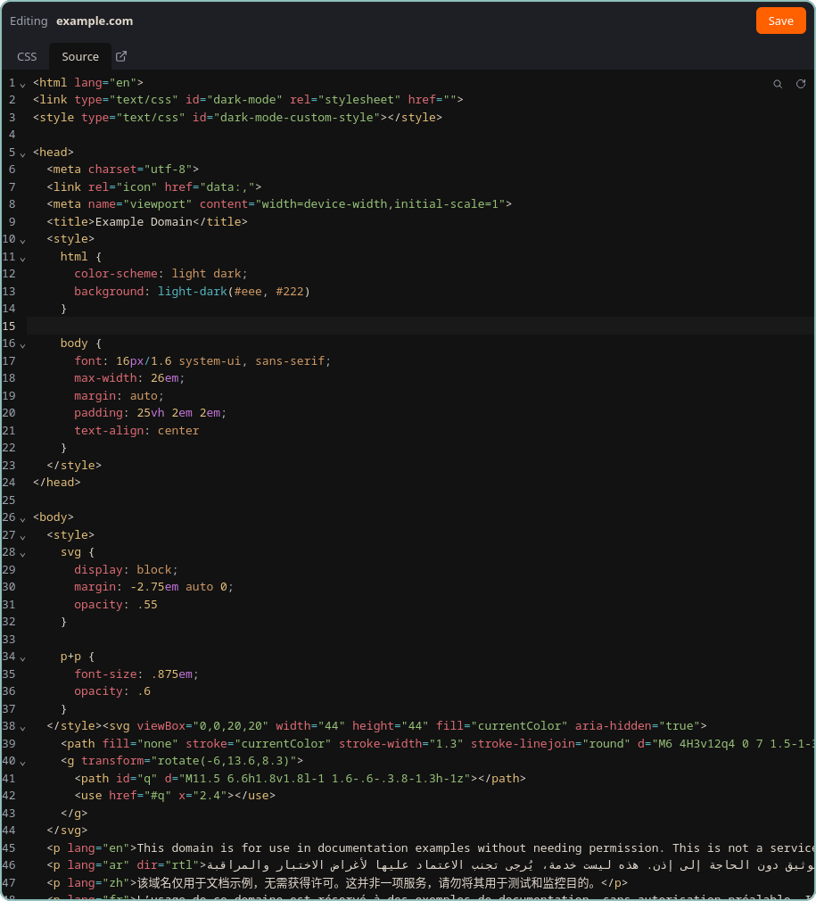
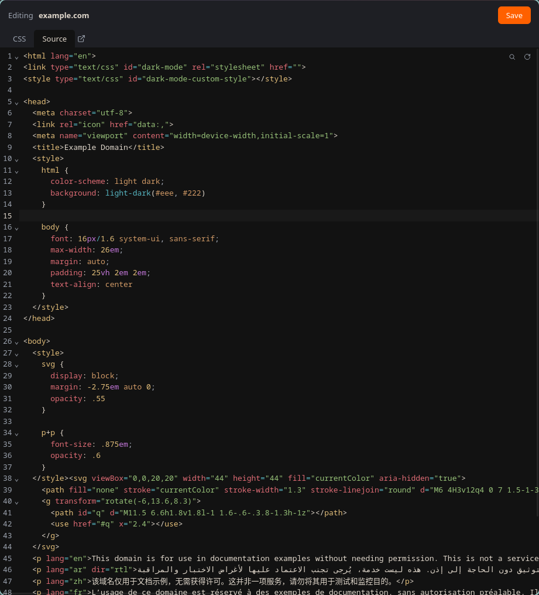

<h1 align="center">
  <br>
   
  <br>
  <p align="center">cInjector</p>
</h1>

A Custom CSS Injection Extension for Firefox.

---


## Screenshots

<p align="center">
  
</p>
<p align="center">
  
</p>

## Development

**Installing the Extension for Development:**

Go to [this page](about:debugging#/runtime/this-firefox), click on "Load Temporary Add-on..." and select the manifest.json inside of this Folder.

**Reloading the Extension:**

Rebuild:

```sh
npm run build
```

Then, go to [this page](about:debugging#/runtime/this-firefox) and click on reload below the "Custom CSS Injector" addon.

**Building a Release:**

Needs nodejs 22

```sh
npm ci
./package.sh
```

Zip goes to `web-ext-artifacts/`. With `jwt_issuer` and `jwt_secret` in `.env`, it also gets signed

## Credits

For the Editor, I used [CodeMirror 6](https://codemirror.net/) so it feels like it's an actual editor.
